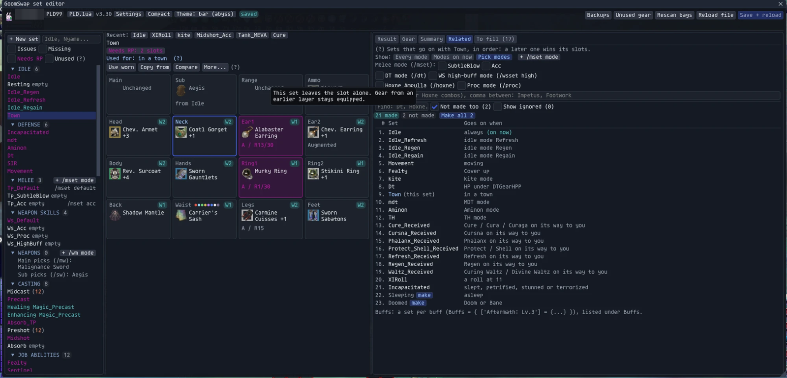
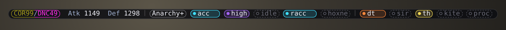

# GoomSwap

A gear-set engine for Final Fantasy XI. Define sets in one job file; GoomSwap layers the relevant sets for spells,
abilities, weapon skills, combat modes, defense and utility gear.

For **Ashita v4** (LuAshitacast). Start from an example job file and the in-game set editor (`/gcedit`).

More pictures of the editor (in game, and mockups of some panels) are in [its docs](docs/gcedit.md).

## Features

- **Gear engine:** weapon modes, TP and Aftermath holds, defense modes, idle Regen/Refresh, status gear, precast and
  midcast layers, TH, elemental gear, magic burst, Moonshade, and safety checks before actions.
- **Set editor** (`/gcedit`): sets, rules, modes, settings and new job files, all without a text editor. It shows
  what each action wore and why, stat totals with caps, what is left to fill, and the sets you could add.
- **Rules:** "when this, wear that" (a buff up, low MP, a spell on you, a mode...). **Convert** turns your job file's
  own `if`s into rules with the same result ([Rules](docs/rules.md)).
- **Bring your files:** `/gcimport` reads a GearSwap job file's sets; **Adopt** takes over a plain LuAshitacast file.
- **Packer:** `/lac gear` (the Packer plugin) fetches every set's gear and the items GoomSwap uses.
- **Bar and HUD:** `/gcbar` status bar, `/gchud` multibox controls, `/gcgear` worn-gear grid.
- **Drafts:** `/gcbuild` writes a job file from the gear you carry.

## Install

**Ashita v4**

1. Copy `common/` and `examples/` into `Ashita-V4beta-main/config/addons/luashitacast/`.
2. Copy `examples/<JOB>.lua` into your character's LuAshitacast profile folder (or, once one job file loads, make the
   others in `/gcedit`: the file name menu, **New job file**). Add `examples/char.lua` there if you want
   per-character settings.
3. Load LuAshitacast and your job file: `/addon load luashitacast`, then `/lac load`.
4. Optional: Ashita's Packer plugin (`/load packer`) for `/lac gear`, which puts your sets' gear and Packer items in
   your bags (`/gcedit` Settings, **Get gear now**).
5. Load Ashita's `debuff` addon (`/addon load debuff`): it provides `/cancel`, which GoomSwap uses to drop Sneak or
   Stoneskin before recasting them and to cancel Stoneskin while you are asleep.
6. Einherjar: a separate addon, not part of this repository (`/ejenter`).
7. Sequencer and PacketFlow are recommended for multiboxing and action timing: [Sequencer](https://github.com/ThornyFFXI/Sequencer),
   [PacketFlow](https://github.com/ThornyFFXI/PacketFlow). [Multisend](https://github.com/ThornyFFXI/Multisend)
   (`/load multisend`) lets your boxes tell each other about incoming Cures and buffs (received sets).

## First use

1. Load the matching example job file. `/lac newlua` can create the profile folder and an empty job file. Coming
   from GearSwap: put your job file in your character's luashitacast folder and run `/gcimport <file>`.
2. Run `/gcbuild` to create `<JOB>.proposed.lua` with gear you own, or open `/gcedit` and choose **Keep only my gear**.
3. Use the editor's **To fill** tab to fill empty or missing slots: click one, pick the item, and it takes you back to
   the list for the next. **Use worn** copies your current gear into a set; **+ N to add** under a heading makes a set
   it usually has.
4. Choose **Save + reload**. The previous file is backed up; the newest three editor backups per job are kept
   by default (`EditorBackupKeep = 0` keeps all). Other job files use **Save file** without changing your active job.
5. Run `/checksets`; the editor's **What goes on** tab shows what an action actually put on, slot by slot.

While a job file is new (still the example, or a `/gcbuild` draft), the editor shows a **Getting started** list of
these steps, each ticked from what GoomSwap sees, with a button for each. It goes away once every step is done, or
with **Hide** (until you restart the game).

## Weapon modes

A weapon mode is a `Weapon_<Name>` set (Main, Sub, Range, Ammo). `/wm <name>` picks it (F7 cycles). While it is on,
its own sets go over their base: `Tp_<Name>` over `Tp_Default`, `Ws_<Name>`, `Savage Blade_<Name>`... The engine
wears `Weapon_<Name>_1h` when you can't dual wield, and `Weapon_<Name>Acc` with `/mset acc`.

**Add one** (example: Mpu Gandring as `/wm mpu`):

1. Hold the weapons, open `/gcedit`, and press **+ /wm mode** on the WEAPONS heading (or the bar's weapon menu,
   **+ new mode...**).
2. Type `Mpu`. Keep **Start from the weapons you hold** ticked. **Create**.
3. **Weapon sets for /wm Mpu** opens. Tick the sets that should differ with Mpu (`Tp_Mpu`, `Ws_Mpu`...) and **Make**.
   They start empty: fill only what differs.
4. **Save + reload**. The mode is in `/wm`, F7 and the bar. Your job's first mode also becomes the one you load in.

**Remove one:** right-click its `Weapon_` set, **Delete set...**. The box offers to delete the sets worn only with
that mode, and flags settings that still name it. Confirm, then **Save + reload**.

**Swap the weapon:** **Rename set...** (`Weapon_Malignance` to `Weapon_<New>`) renames the mode everywhere the file
names it.

More: [Set editor](docs/gcedit.md#weapon-modes-wm).

## Common commands

| Command | Purpose |
|---|---|
| `/wm [mode] [sub]` | Weapon mode, optionally with a Sub pick; right-click the bar's weapon for a menu |
| `/mw` `/sw` `/rw [item]` | Main/Sub/Range pick over the mode (any item in a `Weapon_` set) |
| `/mset [mode]` | Melee mode, such as Acc or SubtleBlow |
| `/def` | Cycle DT, MDT, Aminon and off |
| `/th` `/sir` `/kite` | Treasure Hunter, spell interruption resistance, movement gear |
| `/idleset [mode]` | Idle set mode |
| `/lock [slots]` `/unlock` | Hold equipment slots |
| `/gcbar` `/gchud` `/gcgear` | Status bar, multibox HUD, worn-gear grid |
| `/checksets` | Validate sets |
| `/gcbuild` `/gcedit [set]` | Build or edit job sets |
| `/gcimport <file> [JOB]` | A GearSwap job file's sets as a draft to edit and save |
| `/lac gear` | Fetch every set's gear and your Packer items (Packer plugin) |
| `/gchelp` | In-game command help |

See [all commands and keys](docs/commands.md).

## Documentation

- [Sets and job files](docs/sets.md)
- [Commands and keys](docs/commands.md)
- [Settings](docs/settings.md)
- [Engine behavior](docs/features.md)
- [Status bar and HUD](docs/bar.md)
- [Building a job file](docs/gcbuild.md)
- [Set editor](docs/gcedit.md)
- [Rules, Convert, Adopt](docs/rules.md)

## Troubleshooting

- **Changes do not apply:** `/lac reload`.
- **A slot will not change:** `/unlock`; check TP and Aftermath weapon holds.
- **A set is empty or gear is missing:** run `/checksets` and inspect the set in `/gcedit`.
- **An action is cancelled:** read the reason in chat; the editor's What goes on tab shows the gear path.
- **Bar or HUD is hidden:** `/gcbar on`, `/gchud on`, or `/gcbar reset`; the gear grid: `/gcgear on`, `/gcgear reset`.
