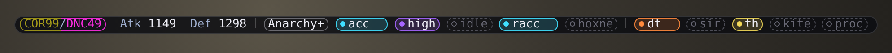

# GoomSwap

A gear-swap engine for FFXI, built for multiboxing. You write gear sets in a job file; GoomSwap wears them and
layers weapons, defense, TH, obi and more on top.

Runs on **Ashita v4** (LuAshitacast) and **Windower 4** (GearSwap) with the same job files.

## What it does

| | |
|---|---|
| **Weapons** | `/wm` modes, one-handed sets without Dual Wield, no automatic swap that costs TP or Aftermath |
| **Defense** | `/def` (DT, MDT, Aminon), idle Regen/Refresh/DT by HP and MP, sets for sleep, stun, doom, weakness |
| **Casting** | TH until the mob is tagged, SIR, obi/Orpheus, Moonshade, Burst gear on a live skillchain |
| **Items** | packer, enchanted items, warp rings, Hoxne Ampulla |
| **Multibox** | a status bar per box; hover it and every other box drops in, click to drive any of them |
| **Checks** | actions that would fail are cancelled with the reason; `/checksets`; `/gctrace` |
| **Getting started** | `/gcbuild` drafts a job file from the gear you own; a converter for Selindrile files |

## Install

**Ashita v4**

1. `common/` and `examples/` into `Ashita/config/addons/luashitacast/`.
2. `examples/<JOB>.lua` into `luashitacast/<Name>_<id>/`, your gear in it. Optional: `examples/char.lua` there
   (that character's food, packer list, settings).
3. `/addon load luashitacast`, `/lac load`.
4. Recommended: Thorny's [Sequencer](https://github.com/ThornyFFXI/Sequencer) (else lag loses actions) and
   [PacketFlow](https://github.com/ThornyFFXI/PacketFlow) plugins.

**Windower 4:** see [GoomSwap on Windower](docs/windower.md) — install, what differs, and moving over from
Selindrile.

## First steps

1. **Get a job file with your gear.** Either fill `Idle`, `Tp_Default` and `Ws_Default` in your copy of the example,
   or type `/gcbuild`: it writes `<JOB>.proposed.lua`, the example with only the gear you own
   ([how it works](docs/gcbuild.md)).
2. **Check it.** `/checksets` names empty sets and misspellings; `/gctrace` shows what each action wore.
3. Leave `gSettings.FastCast` at 0: cast times are learned.

Sets are named after the action: `['Savage Blade']`, `['Cure']` (also used for Cure IV), `['Berserk']`.

## Commands you'll use most

| Command | Does |
|---|---|
| `/wm [name]` | weapon mode |
| `/mset [acc\|sb]` | melee mode: `Tp_Acc`, `Ws_Acc`... |
| `/def` | DT → MDT → Aminon → off |
| `/th` `/sir` `/kite` | TH until tagged, SIR set on casts, Movement set |
| `/idleset [refresh\|regen]` | idle set |
| `/lock [slots]` `/unlock` | freeze slots |
| `/gcbar` `/gchud` | the status bar, and the other boxes under it |
| `/checksets` `/gctrace` | check your sets, see what an action wore |
| `/gcbuild` `/gcaudit` | draft a job file from your gear; check your job file against your bags |
| `/gchelp` | everything else, in game |

Windower: `//wm` or `//gs c wm`. Every box at once: `/mss /wm` (Multisend). [All commands and keys](docs/commands.md).

## Documentation

| Page | What's in it |
|---|---|
| [Sets and job files](docs/sets.md) | set names, how sets stack, the job file, helpers |
| [Commands and keys](docs/commands.md) | every command, the F-key layout, your own keys |
| [Settings](docs/settings.md) | where settings go, the ones most changed, the full list |
| [What the engine does](docs/features.md) | weapons, defense and locks, Hoxne, magic burst, items, action checks |
| [Status bar and HUD](docs/bar.md) | reading the bar, clicking it, colours |
| [`/gcbuild` and `/gcaudit`](docs/gcbuild.md) | a job file from the gear you own; your job file checked against your bags |
| [Windower](docs/windower.md) | install, differences, augments, coming from Selindrile |

## Something wrong

| Problem | Check |
|---|---|
| Edit does nothing | `/lac reload` / `//gs reload` |
| Windower loads nothing | red line says what; no `[GoomSwap]` line: see [Windower](docs/windower.md) |
| `attempt to index global 'gFunc'` | job file in `data/<Name>/`: move to `data/goomswap/<Name>/` |
| Slot won't change | `/unlock` (names holders); TP/Aftermath hold (`/wm <mode> force`) |
| TP-set weapon never shows | engaged the mode wins: `/wm none`, `/mainset none` |
| Wrong gear | `/checksets`, spelling, `/gctrace` |
| Action cancelled | chat says why |
| Bar or HUD gone | `/gcbar on`, `/gchud on`, `/gcbar reset` |

## Tests

`luajit tests/run.lua` from the repo root, no game needed. Runs on every pull request.
