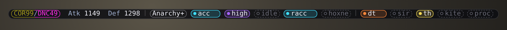

# Status bar and HUD

[← Back to the README](../README.md)

One window. The **bar** shows this box; hover it and every other box **drops in under it**, one line each (the
HUD). Click a line to drive that box.

- **Show:** `/gcbar` (or `DisplayBar = true`). `/gchud` turns the drop on, and the bar with it; `HUDOwners` boxes
  have it on at load.
- **Place:** centred at the top; with the drop on, at the right with room for the open drop (clear of status timers). Drag it
  anywhere (saved per character; within 8px of the top it snaps flush); `/gcbar reset` puts it back.
- **Size:** `/gcbar scale 0.5`–`3` (text and pills; saved per character).
- **Sync:** each box shares its modes when they change (checked 4x/s); the box with the drop reads them twice a
  second (`luashitacast/hud/`).

**A line**, left to right:

| Part | Shows |
|---|---|
| Job / name | Yours: job box (main \| sub outline), `Atk` `Def`. Others: name (first half of the letters in the main job's colour, the rest the sub's) and job/levels |
| Weapon | the weapon mode, coloured by its weapon (below); `+` = a slot pick (`/mw` `/subw` `/rw` `/ammoset`) changed |
| Modes | `melee` `ws` `idle` `nuke` `tank` `pup` `hoxne`...; blank = that job has no such mode |
| `def`, toggles | `def` (DT / MDT / Aminon), `sir` `th` `kite` `proc`, the job's own (`burst`, `harp`, `lock`...) |

- **Pills:** set or on = coloured outline, tint and dot, showing the value (`acc`, `mp`, `dt`); default or off =
  dashed grey and a ring, showing its name (`melee`, `idle`, `sir`).
- **Colours** follow goomui's colour preset for this character when goomui is installed (same 30 presets, by meaning:
  MP blue for `mp`/`mdt`, HP green for `hp`, TP for `tp`...); job and weapon colours stay. `Theme = 'ocean'` in
  char.lua picks one, `'goomswap'` keeps GoomSwap's own; `/gcbar theme [name]` tries one until reload. `/gcedit`
  has its own (its Theme button; same as the bar until you pick one).
- **Click** a pill: cycles it on that box (ctrl+click the weapon: `/mset`). **Right-click** a line's weapon pill:
  that box's weapon modes and Main/Sub/Range/Ammo picks, side by side; any other mode pill: its values. Click one and
  that box takes it. The drop stays open while a menu is. **Hover** a pill: its full value and what each click does.
- **Hide a pill** you don't use: `BarHide = { 'harp', 'lock' }` (the words on the pills; GoomSwap settings, Modes or
  Bar & HUD). Its command still works.
- **Your own line's menus** also add things in `/gcedit`:
  - weapon menu, **+ new mode...**: New weapon mode (asks for the `/wm` name);
  - under each pick list, **+ add...**: GoomSwap settings on that list (`MainModes`...; every item in a `Weapon_` set
    is a pick already);
  - **ctrl+click** a mode: opens its `Weapon_` set;
  - melee menu, **+ new mode...**: a new `/mset` mode.
- **Fixed width:** each column as wide as its widest value, `Atk`/`Def` as 4 digits; cycling never moves anything.
- **Your columns first:** the bar is only as wide as your line; columns only the other boxes have (a mage's `nuke`, a
  BRD's `harp`) sit after a divider and show with the drop. Opening it never moves your pills.
- A job without weapon modes (WHM...) shows `melee` `ws` `hoxne` only once changed.

<b>Pill colours</b>

| Pill | Colours |
|---|---|
| melee | `acc` cyan, `sb` magenta (a job's own modes: lime, salmon, periwinkle) |
| ws / idle | `high` purple / `mp` blue, `hp` green, `tp` yellow |
| nuke | `macc` teal, `oa` salmon |
| tank / hoxne | `main` periwinkle, `meva` lime / bronze |
| def | `dt` orange, `mdt` blue, `amin` mauve (`+` = more than one) |
| toggles | `sir` teal, `th` gold, `kite` green, `proc` red, `burst` pink |
| weapon | relic light blue, mythic and ergon green, empyrean red, prime purple, aeonic orange, TP bonus (Sparrowhawk +2, Anarchy +2) dark blue, others grey |

The weapon's class comes from the mode's Main, else Range, else Sub; add your own with
`WeaponClass = { ['Item Name'] = 'tpbonus' }`. Each of the 22 jobs has its own colour.

- **Drop:** opens on hover; in the screen's bottom half the lines rise above the bar. The box with it on also prints
  the other boxes' chat lines as `[Name]`.
- **A box's gear:** hover its name/job in the drop: its 16 slots with the [gear grid](#gear-grid-gcgear)'s marks, then
  what holds which slot (encumbered, `/lock`, Aminon/item use..., TP hold, needs RP, missed swaps) and how old it is.
  Each box shares its slots in `luashitacast/hud/<Name>.gear` when they change (every 3s at least).
- `/gchud debug` lists what it reads.

## Gear grid (`/gcgear`)

What you have on, 4x4 in the equipment window's order (Main Sub Range Ammo / Head Neck Ear1 Ear2 / Body Hands Ring1
Ring2 / Back Waist Legs Feet), drawn like atom0s' equipmon: the game's item icons, the ammo count, a red X on a slot
the game has encumbered (Salvage...). On top of that, corner marks say what keeps a slot (no borders: some item
icons have their own coloured frame):

| Mark | Means |
|---|---|
| Red padlock, bottom left | your `/lock` |
| Purple padlock, bottom left | Aminon, Hoxne, `/proc`, an item use (`/gce`, `/warpring`...) or a hold (`/capacity` `/jubilee` `/dynamisrp` `/abyproc`) |
| Amber dot, bottom right | held to keep your TP (`WeaponTPGuard`) or Aftermath (`AftermathHold`): Main, Sub, Range; weapon commands (`/wm`...) still swap |
| Pink corner | still needs RP (rank below its cap) |
| Red X | encumbered: the game has locked the slot |
| Orange `!`, top left | a swap that didn't go on: GoomSwap's last swap named another item, nothing holds the slot, still not on 2s later |

**Hover** a slot: the item (and its rank), the set that put it on (`From Tp_Default (Engaged)`; `Last swap asked for
...` when what you wear isn't what GoomSwap's last swap named, e.g. a locked slot), and every lock or hold on it with
the command that frees it. With a `!`, why that item isn't on: not in your bags, in a bag you can't equip from (Safe,
Storage...; LAC's `EquipBags`), your job can't wear it, or it needs a higher level.

**Right-click** a slot: `/gcedit` on the set that put it on (or asked for it), that slot selected. **Ctrl+click**:
`/lock` that slot, again to `/unlock` it. **Alt+click**: take it off. **Shift+click**: a list beside the grid of
your gear that fits the slot (from the bags LAC equips from, for this job and level; its bag on the right, the worn
one tagged, *Take it off* first); click one to wear it. An item you have in more than one version (augments or
path, e.g. JSE capes) gets a row per version with its augments, main stat first (hover a row for all of them), and
that exact copy is the one put on. Both keep the slot as you left it with
your `/lock` (else the next swap would put the set's piece back): `/unlock <slot>` hands it back to your sets. They
won't change a slot another feature holds (its off command is named) or a weapon held for your TP (Ctrl+click it
first).

- **Window:** `/gcgear` (off at first). Bare like equipmon without its backgrounds: icons only, 1px apart. Drag it
  anywhere (saved per character); hidden with the game's interface, as the bar is.
- **Look:** `/gcgear scale 0.5`–`3`, `/gcgear alpha 0.2`–`1` (the icons' opacity; the marks stay solid),
  `/gcgear bg on` (the bar's panel behind it), `/gcgear reset` (first spot, scale and alpha 1). Saved per character.
- **Colours** follow the bar's colour preset (`Theme`, goomui's), kept apart from each other.
- Replaces equipmon: unload it (`/addon unload equipmon`) once this is placed.
- The other boxes' grids: hover a name in the `/gchud` drop (above).

