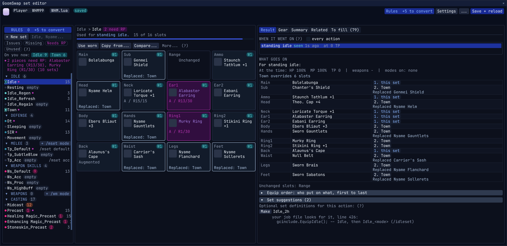
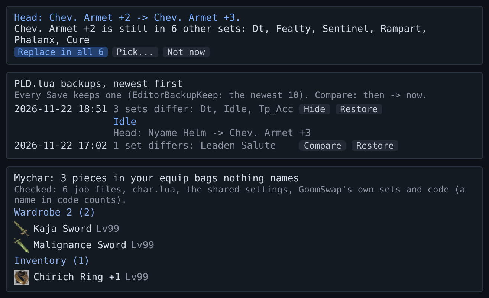
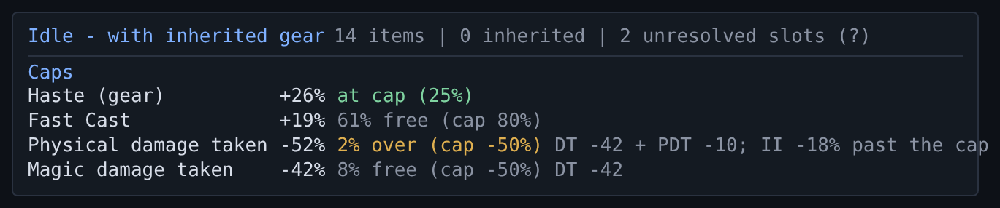
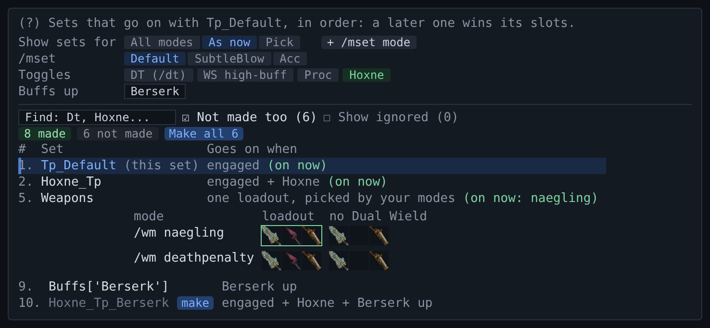

# Set editor: `/gcedit`

[Back to README](../README.md)

Edits your loaded job file. Changes stay in memory until you confirm a save. `/gcedit Savage Blade` opens a set.

## Layout

The top bar: your character and job, the job file (its menu opens your other job files and **New job file**), the save
state, then **Rules**, **GoomSwap settings**, **Editor** and **Save + reload**. **Editor** (the editor itself) holds
**Spacing** (**Compact** | **Comfortable**, with a line saying what the one on does), then the theme, **Backups**,
**Unused gear**, **Rescan bags**, **Reload file**, **Remove /gcbuild notes** (a `/gcbuild` draft's header and its notes after
slots, on Save; the slots it left out stay for **To fill**) and Diagnostics.

Three panes of fixed width (nothing to drag): your sets on the left (about 34 characters wide), the open set in the
middle (four slot cards wide; three or two on a narrow window), and the right pane for the rest: **What goes on**,
**Gear**, **Stats**, **Compare** (while one is picked), **Related**, **To fill**. Sets show their names as in your
file; hover one for what it is for in plain words (`Tp_Default`: *Fighting*). The Rules page uses the whole width
(**< Sets** goes back).

The window opens no taller than about 70% of the screen, clear of a hotbar along the bottom: some addons (tHotBar
among them) act on a click even when the editor is over them, so keep it off them. Drag its corner to resize it.

## Rules

**Rules** in the top bar (or **RULES** over the set list; a second click on the top bar's goes back to the set):
"when this, wear that" without code, and **Convert** for your job file's own `if`s; the button says how many it can
take. Most swaps need no rule: a set with a weapon skill's, ability's or spell's exact name (`Savage Blade`,
`Sentinel`, `Cure`) goes on by itself, with its `/wm` and `/mset` versions; the Rules page says so at the top. See
[Rules](rules.md).

## New job file

The file name menu (top bar) ends with **New job file**: pick a job, then **From my gear** (the example with only what
you own, as a draft to fill: `/gcbuild`), **The example** as it is, or **Empty sets** (the example's set names,
handlers and rules, no gear). The last two write `<JOB>.lua` in your character folder when it has none; on your
current job it loads at once. A GearSwap file: `/gcimport <file>` ([Rules](rules.md) for its logic).

A new job file (still the example as is, or a `/gcbuild` draft) gets a **Getting started** list at the top: your own
gear (**Keep only my gear**), what is left **To fill**, a `/wm` weapon mode (or `/mw` `/sw` picks), one **Save +
reload**, and the status bar (`/gcbar`). Each step ticks itself; the list goes once all are done, or with **Hide**
(for that job file).

## Add a set or mode

1. **+ New set**, type a name, **Create**. Names the engine looks for that your file lacks are suggested as you
   type (your spells, abilities and weapon skills too), and the box says what would wear a set by that name
   (`Absorb-TP`: *Worn: when Absorb-TP goes off (midcast).*). Tick *Copy slots from ...* to start from the open set.
2. Click a slot and pick gear from **Gear** (or **Use worn** for everything you have on).
3. **Save + reload**, check the review, confirm.

| To add | Do |
|---|---|
| A set for an action | Name it after the action: `Barrage`, `Cure`, `Savage Blade` |
| A weapon mode (`/wm`) | **+ /wm mode** (the WEAPONS heading, Getting started, the bar) asks for its `/wm` name (one word; a name `/wm` would read as another mode's `/mset` set is refused) and makes `Weapon_<Name>` from the weapons you hold (untick to start empty); its card shows the weapon row only. Save adds it to `gcinclude.WeaponModes` (any one-word `Weapon_` set the engine doesn't wear for another mode: `Weapon_MpuTP` is its own mode, `Weapon_MpuAcc` is `/wm Mpu` with `/mset Acc`). A `Weapon_` set puts on Main, Sub, Range and Ammo only: armor in one is flagged under its buttons (**Move to Tp_<Name>**, worn over `Tp_Default` while the mode is on, or **Clear them**), **Use worn** copies only those four, and a `Weapon_` set `/wm` doesn't list is flagged with **Add /wm <Name>**. The job's first one also becomes **Weapons on load** (`DefaultWeapons`) when that was None (**Keep None** in its **Weapon sets...** undoes it). Deleting the set takes it out on Save, with the sets worn only with that mode (`Tp_<Name>`, `Ws_<Name>_Acc`, `Savage Blade_<Name>`, `Weapon_<Name>_1h`...; untick to keep them; ones your code names are kept); a `DefaultWeapons` / `WeaponRoles` still naming it is flagged (change it in **GoomSwap settings**). `Weapon_<Name>_1h` is used when you can't dual wield, `Weapon_<Name>Acc` (or `Weapon_<Name>_Acc`) with `/mset acc`. **Weapon sets...** (the set's header or right-click; offered when you make one) lists every set the mode can have: its `_1h` and `/mset` weapon sets (made as copies of `Weapon_<Name>`, spelled like your file's) and the layers below; tick the missing ones and **Make**. After **Save + reload** the mode is on the bar and HUD (the weapon pill and its right-click menu), coloured by its Main |
| TP or WS gear for one weapon | `Tp_<Name>` / `Ws_<Name>` (`Tp_Chango`): worn over `Tp_Default` / `Ws_Default` while `/wm <Name>` is on; `Tp_Chango_Acc` with `/mset acc` too. **Weapon sets...** on the `Weapon_<Name>` set makes the ones you tick, empty: fill only what differs, and later changes to the base still apply (or tick **Layers start as a copy of their base**). Right-click `Tp_Default` (or `Tp_Acc`, `Dt`, `Idle`, a WS's set): **Copy as a weapon set** makes one full copy |
| TP or WS gear for a weapon type | `Tp_2h` / `Tp_1h` (and `Ws_`, `Dt_`, `Idle_`...): for a weapon with no set of its own, by its Main ([How sets stack](sets.md#how-sets-stack)) |
| A Main/Sub/Range pick (`/mw` `/sw` `/rw`) | Nothing: every item in a `Weapon_` set is one. Others go in `gcinclude.SubModes` (etc.) in the file |
| A COR/RNG gun | Add its name to `gcinclude.RangeModes` in the file |
| A melee mode (`/mset`) | **+ /mset mode** on the **MELEE** heading (also on the **Related** tab): name it, tick the sets to make for it (`Tp_<mode>` and `Ws_<mode>` start ticked; `Dt_<mode>` and each weapon skill's `Savage Blade_<mode>` offered), **Add**. They start empty: fill only what differs. **Save + reload** adds it to `gcinclude.MeleeModes`; `/mset <mode>` then wears each over its base |
| A set for one buff | Open `Buffs` (idle/engaged), `Buffs_Ws` or `Buffs_Midcast`, type the buff's name as the game shows it, **New buff set**. Each shows under its parent (`Buffs['Aftermath: Lv.3']`) and edits, deletes and copies to other jobs like any set. Renaming one also renames code that takes it from its parent (`sets.Buffs['Haste']`, `sets.Buffs.Haste`) |

## Headings

The set list is grouped under headings (Idle, Defense, Melee, Weapons...). Arrange them your way:

- **Right-click a heading:** Move up / Move down, **New heading below** (type its name first), and for a heading
  of your own **Rename** and **Remove this heading** (its sets go back where their names put them).
  **Built-in order** undoes all of it.
- **Right-click a set:** **Move to heading** (a submenu) puts that set under any heading; **Back to where its name
  puts it**, at the end of that submenu, undoes the move. **Move up / Move down** reorders it inside its heading.
- **Drag a set** onto a heading to move it there, or onto another set to put it just before that one.
- **Buff sets** (`Buffs['Haste']`) sit under their parent in file order. Drag one or use **Move to heading** to put
  it elsewhere (shown by its full name there); **Back under Buffs** returns it.
- **Hide** (heading menu): **Hide on <JOB>** or **Hide on every job**. **Show hidden** (beside the filters) shows
  them again, marked hidden; a search always shows them. **Show again** undoes it.
- **Sets in it** (heading menu): **File order**, **A-Z**, or **Your order** (what Move up / down and dragging make).
- Folded headings stay folded until you restart the game (Save's reload keeps them).
- **+ N to add** (a framed button, last row of a heading; **+ add** when it has nothing to suggest): the sets a job file
  usually has under it that yours doesn't yet, most useful first: the engine's usual ones, the job example's, a `/mset`
  mode's `Tp_` and a `/wm` mode's `Tp_`/`Ws_`, the ability groups your `HandleAbility` wears by name (DNC: `Step`,
  `Samba`, `Jig`, `Flourish`, under JOB ABILITIES), then the job abilities and weapon skills you know (not spells: too
  many), under BUFFS `Buffs['Saber Dance']` for each of your JAs the game has a buff by (worn while it is up, idle and
  engaged), and under **More** the one-fight or one-state sets (Aminon, Sleeping, Doomed...; the count leaves them out).
  Each says what it is for (`Idle_Regain`: *Standing: Regain*) with **Make** (empty) and **from...** (a copy of a set you
  pick); **Your own name** takes any other set (`Cure IV`). The set is made and opened on its first slot (Head; a
  `Weapon_` set's Main) with the picker, under the heading its name puts it in, unsaved until Save. JOB ABILITIES and
  NAMED WEAPON SKILLS show before your first set there.
- **Wear this when...** (a set's **More...**): the Rules page's builder with Wear set to that set and a moment by its
  heading (weapon skills, abilities, casting, else idle/engaged): pick the conditions and **Save rule**.
- **Share with every character** (heading menu): these headings go into the shared settings file, and every
  character without headings of its own uses them. **Only this character** copies them back into `char.lua`.

Saved at once in the character's `char.lua` (`settings.EditorGroups`, `EditorHidden`, `EditorSort`, `EditorOrder`),
or in the shared file once shared ([Settings](settings.md#every-character-goomswap-sharedlua)), so every job shows the
same headings in the same order; the file is backed up first (once each time the editor opens). You can also
write it by hand:

```lua
EditorGroups = {
    { 'Weapons', 'Weapon_*' },  -- a heading and the set names it takes ('*': any text, any case)
    'Idle', 'Defense', 'Melee', 'Weapon skills', 'Job abilities', 'Casting', 'Named weapon skills', 'Hoxne',
    { 'Two-handed', 'Tp_Chango', 'Ws_Chango' }, -- your own heading: these exact sets
},
```

Listed headings come first, in that order; built-in ones you leave out follow, Other last. A set named exactly
under a heading goes there first, then the first heading whose `*` pattern takes it, else its built-in heading.

```lua
EditorHidden = { all = { 'Received' }, WAR = { 'Hoxne' } }, -- hidden on every job / on WAR
EditorSort = { Melee = 'own', Casting = 'az' },             -- 'file' (the default), 'az', 'own'
EditorOrder = { Melee = { 'Tp_Default', 'Tp_Chango' } },    -- 'own': these first, the rest in file order
```

## Across job files

- **Copy to other jobs** (right-click a set): its pieces into the job files you tick (new sets ticked; a file that
  has the set already replaces only the slots this set fills). A piece that job can't wear (by the item's job
  list, or above that job's level) is left out and listed; slots this set leaves empty keep that file's own.
  Each file is backed up and written only if it still loads. A job you have loaded needs `/lac reload` after.
- **Find in every job file** (right-click a slot): every set that names the item, in this file (as edited) and
  the others (as saved). Click one to open it there.
- **/wm order** (right-click a `Weapon_` set): **Earlier / Later in /wm** reorders the cycle; written on Save.
- **Unused** (filter): sets nothing seems to look for: no trigger by their name, not one of the engine's names,
  not a variant of another set, never named in the job file. **Delete these** stages them for Save. It is
  cautious, but check: a set your own code builds a name for can still look unused.

## Settings

**GoomSwap settings** (top bar) is GoomSwap's own behaviour, for every job file that loads it: what an include
file's settings are in GearSwap or LuAshitacast (not the editor's look: that's **Editor**). It lists every GoomSwap setting by a plain name (`DT gear below HP`; hover it for what it does
and its key, `DTGearHPP`), its value, and a tag for where it comes from: **default**, **Everyone** (the shared
file), your character (`char.lua`) or your character on this job (the job file open in the editor). **Applies to**
at the top picks where a change goes: **<Name> - all jobs** (`char.lua`), **<Name> - <JOB>** (the job file) or
**Everyone**. Categories on the left (Common, Idle & defense, Weapons, Casting, Weapon skills, Items & Packer, Keys,
Bar & HUD, Editor, **<JOB> options**, **All (advanced)**); **find a setting** searches all of them. Change a value,
**Save**; **Clear** takes it out of that file. `char.lua` and the shared file are written at once; changes for
**<Name> - <JOB>** wait for the editor's Save, like set edits, as `gcinclude.settings.X = value;` lines (a new one
goes just before `gcinclude.Initialize()`). **<JOB> options** edits the job file's own options the same way: `DefaultWeapons`, `WeaponRoles`, `MainModes` `SubModes` `RangeModes`,
`WeaponItemMap`, `AlwaysDualWield`, `NukeModes`, `Packer` (`profile.Packer`, with **Get gear now**: `/lac gear`), `SIRSkip` `THSkip`, `CureObi`, `SafeAmmo`, `RangeAmmo`,
`CORmsg`, `LockstyleSet` (`WeaponModes` and `MeleeModes` are shown; Weapon_ sets and the headings' **+ /wm mode**,
**+ /mset mode** change them).
A value written as code, or set in more than one place in the file, is left for you to edit there. True/false are
checkboxes, numbers and text are boxes; lists of names (`SIRSkip`, `HUDOwners`, `MainModes`...) are chips (**x**
takes one out, a box adds one), name -> value tables (`HUDAbbr`, `ElementalWS`, `WeaponRoles`...) are rows,
**Keybinds** are modifier ticks, a key and a command, and **Packer** lists are items with a count, a stack or all
(**Packer (every job)** for char.lua or the shared file, **Packer** under the job file's own options, with **Get gear
now**). Other tables (`ElementGear`, `OrpheusPoints`...) are Lua in their box. Hover a setting for what it does, an example typed the way its box takes it, and its value in
each file; an empty box shows the example greyed. Numbers keep to their range (HP/MP % 0-100, TP 0-3000).
Settings most never change (item names like `HoxneItem`, game data, timing windows) show under **All (advanced)**,
when a file sets one, or in a search; job options only some jobs read (`NukeModes`, `CORmsg`) show on those jobs. A value the engine would refuse on load is refused here. `/lac reload` applies it everywhere;
a job file's own setting still wins. Details: [Settings](settings.md).

## Find your way

- A comment right after a set's `{` in the job file shows under its name as **Note** (`Foe = { -- Lullaby keeps
  your weapons`).
- **Used for** (over the slots) says when a set goes on: GoomSwap's own trigger for it, else where your job file's
  code wears it, read from the file (`moving, not engaged (HandleDefault, line 732)`); hover it for each place.
- **WEAPONS** and **MELEE** always show, with **+ /wm mode** / **+ /mset mode** at the heading's right end (WEAPONS:
  New weapon mode, which asks for the `/wm` name; MELEE: the new `/mset` mode and its sets). Each
  set there says, at its right end, what wears it: `/mset acc` (`Tp_Acc`), `/wm naegling`, `no dual wield`
  (`Weapon_Naegling_1h`), cut with `...` when the panel is narrow; hover it for the sentence. A `/mset` mode with no `Tp_<mode>` set is in MELEE's
  **+ N to add**. With no `Weapon_` set WEAPONS lists the file's picks
  (`Main picks (/mw): ...`, from `MainModes` `SubModes` `RangeModes`). A `DefaultWeapons` or
  `WeaponRoles` naming a weapon or mode nothing offers is flagged there and in **GoomSwap settings**: the engine skips it at
  load without a word.
- Hover a set's name (the list, **Related**): its gear as icons, 4x4 in the equipment screen's order (a slot it
  leaves out is blank; rows after its last item are left out, so a weapon set is one row), over the usual hover
  text.
- Search the set list by a set's name or an item (`nyame`: every set wearing a Nyame piece, as edited), or fold its
  headings; for your main sets at the top, make a heading of your own and move them into it
  ([Headings](#headings)). The chips over it filter it: **Unsaved**, **Issues**, **Missing**, **Needs RP**,
  **Unused** (and **Show hidden**); a chip fills in blue while on. The `?` after them shows the colours as your theme
  draws them.
- Each row: a dot before the name for its state (GoomSwap's own colours; a theme recolours them but keeps them
  apart): amber unsaved, red missing gear, then green (all 16 slots, or a ready overlay) and teal (all 12 armor
  slots; weapons left out on purpose). After the name, small tags: empty slots (amber) and pieces not owned (red),
  each a count (hover: which), **code** or **empty**, and a violet dot when a piece in it needs RP. The number at
  the right end is how many of the 16 slots it names (MELEE and WEAPONS show the command that puts it on there).
  Over the list, one line says how many pieces need RP and in how many sets (hover: which; click: only those sets), and **On you
  now** shows the sets wearing something on you, the most slots first (click one to open it); their dots get a green
  ring.
- Spacing is one GoomSwap setting for every job (`EditorSpacing` in char.lua; the **Editor** menu writes it).
- **Theme** (under **Editor**): the editor's colours. Same as the bar (default), **Match goomui** (the theme goomui saved for
  this character), GoomSwap's own, or any of the 30 presets; hover one to preview. Kept per character
  (`gcedit-theme.txt`); the bar keeps its own.
- **Rescan bags** refreshes ownership and keeps edits. Storage Slip gear counts as owned and shows its slip.
- **Backups** lists this file's editor backups (every Save keeps one; `EditorBackupKeep`, the newest 3), newest
  first, each with the sets that differ from the file now; **Compare** shows them slot by slot (then -> now).
  **Restore** puts one back: the file is backed up first, then replaced and reloaded. Not with unsaved edits.
- **Recent** (over the slots): the sets you opened last, newest first; a click opens one. Kept per job.
- The set you're editing has its title under it: its heading and name (`Idle > Town`), its tags as pills (**2 need
  RP**: click for where else those pieces are; worn by name, renamed, new), one line with what it is used for and how
  many of the 16 slots it names, and a meter of those slots. Under it: **Undo edit** / **Redo** (after an edit),
  **Use worn**, **Copy from...**, **Compare...** (and **Weapon sets...** on a `/wm` set), **More...** (Revert,
  Rename, Delete).



- **Unused gear** lists, by bag, the gear in your Inventory and Wardrobes that nothing of this character names:
  none of its job files, char.lua, the shared settings file, GoomSwap's own sets or its code (Moonshade, obis,
  Warp Ring). A name anywhere as a string counts, code and unsaved edits too. Read only: it moves nothing.



- The **filename** opens the character's other job files. They are edited without changing your active job and
  saved with **Save file** (no reload). Switching with unsaved work asks to keep editing or discard.

## Gear grid and picker

| On a card | Means |
|---|---|
| Blue outline | The slot being edited, or hovered (here or its row in What goes on) |
| No fill | The set leaves this slot alone |
| Amber fill, Unsaved | A pending change |
| Violet rank | Unfinished RP |
| Bag tag (top right): green / amber | Equippable bag / move it to Inventory or a wardrobe |
| Missing | No copy owned |
| Not in this set | A commented-out placeholder |
| Unchanged / Replaced: source | The set leaves the slot alone / a later layer of the selected action (What goes on) wins |
| Faded piece, *from <set>* | Not in this set: the piece an earlier set puts there and that stays (the layers Summary uses) |

- Click a slot, then pick an item from **Gear**; the header shows **Pending** vs **Saved** (paths, augments).
- **Put in other sets...** (over the picker, or right-click a slot card): that piece, exactly as it is (path,
  augments), into the same slot of the sets you tick: grouped by heading, each showing what it has now (sets that
  already have it, write that slot as code, or wear your only copy of that earring or ring in the other ear or ring
  slot, can't be ticked); **All in <heading>** ticks the open set's heading
  (an enmity piece in every job ability). Other versions of the piece (an ambuscade cape with other augments) say
  *now the one you replaced* (what this set had before) or *now another version*; hover one for the augments that
  differ. **Sets with the one you replaced (N)** ticks just those. Each is an unsaved edit: **Undo slot** per set,
  **Undo edit** one at a time; Save writes them.
- Changed a piece (Chev. Armet +2 -> +3) that other sets still have? Under the grid: *The old one is still in 6 other
  sets*, **Replace in all 6**, **Pick...** (tick which) or **Not now** (until the editor closes). A new version of the
  same piece names only what changed: *Back: Rudianos's Mantle (Evasion+2, HP+6 -> Evasion+20, HP+60)*; hover it for
  all the augments of both. An earring or ring is
  found in either slot of the pair (not where the set already wears your only copy of the new one). Each is an
  unsaved edit: **Undo edit** steps back; Save writes them.
- Search matches words anywhere in the name or decoded stats (`nyame damage`); 3+ letters also lists items you don't
  own, after yours, marked not owned, to plan a set (every item is looked through once, a moment the first time).
  Combine **Any job / level**, **Can equip now**, **Needs RP** and **Augmented**. Identical copies share a row; hover
  for their bags. Drag a row onto a card to stage it.
- Right-click a card or row: inspect, choose, **Set displaced rule** (`Slot = 'displaced'`: another item empties
  the slot, e.g. an instrument displacing ammo), undo, or **Clear slot** (earlier gear stays).

## Stats, Inspect, Compare

- **Stats** totals the set's listed gear bonuses including inherited layers (`Idle > Tp_Default > Tp_Acc`);
  untick **Include inherited gear** for the written definition only. **Base: Auto** uses the built-in route; pick a
  base set to change the underlay. Buffs, job code and combat formulas are not simulated (caps are shown over the
  totals, not applied to them); conditional and unknown effects sit under **Other effects / not totaled**.
- Over the totals, **caps**: each stat the gear has against its cap, over (wasted) or room left. Haste (gear) 25%
  (256/1024; listed values are rounded, so 25-26% as listed is at the cap), Fast Cast 80%, Snapshot 70% (merits
  and Flurry count too), Quick Magic 10%, Cure potency 50%; damage taken as the game caps it: physical (DT + PDT),
  magic (DT + MDT) and breath (DT + BDT), each -50%, with the parts shown and the II versions apart (past -50%, up
  to -87.5% in all); one Damage taken row when the gear has DT only. Hover one: where the cap comes from (BG-Wiki,
  FFXIclopedia).



- An item's hover (picker, slot cards) says which sets name it: *In 9 sets: Tp_Default, Midshot... +3*.
- Hover any item for its stats; elemental resistances show as the element's coloured dot and value, as the game's
  icons do (also in Summary, and as a dot row on the card: one value when they all match, a ring for a penalty). **Inspect item below grid** pins it while you pick. Commented, inherited and
  What goes on items can be inspected without adding them.
- **Compare** shows both sets' stats and the difference (green/red by direction), or **Gear changes** slot by
  slot. **Copy definition...** (confirmed) copies the other set's written slots. Hover any count for details.

## Sets, What goes on, Related, To fill

- **More**: Revert set, Discard new set, Rename set, Delete set (undoable until Save).
- **Rename set** is written on Save (a new set is renamed at once): the key and every place your code names it
  (`sets.X`, `ByName('X')`, `EquipSet('X')`; a `Weapon_` set's mode in WeaponModes/DefaultWeapons/WeaponRoles),
  optionally with its variants (`X_Acc`). Comments stay. A set found by its own name (`Idle`, an action) is then
  only worn where your code names it; the dialog warns.
- **Undo edit** steps back through slot changes; **Undo slot** restores the saved definition.
- **Redo** puts back what Undo edit took out, until you make another edit.
- Hover a slot card: its row in **What goes on** lights up (and the other way round), and **...** at the card's
  bottom right opens the slot's menu (the same as a right-click).
- The gear picker shows what each piece changes against the one in the slot now (`DT -3%  HP +8`): green better,
  red worse, % stats first; hover for all of them, before > after. Read from the item's description and
  augments, as Stats does (conditional effects left out).
- **What goes on** shows what an action wore, layer by layer: recorded since load, or expected from your sets and modes.
  **Equip order** lists the layers first to last, each with its pieces as icons (green: still worn; faded orange:
  replaced later, by what on hover), the slots in screen order, and why it went on (*Weapon mode DeathPenalty: its
  weapons go on over the sets before; not fighting, so weapons your idle sets name win*).


- **Related** lists the sets you have that go on with this one, in the order they go on (a later one wins its
  slots): number, set (click to open), when it goes on (`(on now)`: its modes are on in game). The ones your file
  doesn't have are one line under them (*+ 26 you could make*); that line or **Not made too** lists them in their
  place with **make** (**Make all** on top). Every `Weapon_` set is one **Weapons** entry, since only one goes on
  (the one for your `/wm`, its `/mset` version when made, its `_1h` when you can't dual wield): a row per `/wm`
  mode, a column per version (loadout, no Dual Wield, `/mset Acc`...; versions not made only with **Not made too**),
  each cell its Main, Sub and Range as icons (click opens it; outlined: worn now). A set's own `/mset` versions
  (`Dt_Acc`) are chips under it. A search lists them all as rows. A long name or condition is cut with `...`; hover it for all of it,
  what it goes over, the job file line that wears it, and for one not made what goes on instead (its base set,
  GoomSwap's own `Doomed`, ...).
- Related's modes are as the game has them: **Show sets for** All modes / As now / Pick; one **/mset** at a time;
  **Toggles** (DT, WS high-buff, Proc, Hoxne) lit when on. In All modes or As now a click on any of them switches to
  Pick from what was shown. **Buffs up** (`Berserk, Aftermath: Lv.3`) lists each buff's set (`Buffs['Berserk']`;
  the ones your file has are listed anyway) and, with Hoxne, its Hoxne version (`Hoxne_Tp_Berserk`), which goes on
  over the buff set: **make** adds either (a buff set inside `Buffs`).



- **To fill** lists placeholders, missing or unusable items and empty weapon modes; **Fill all** stages one choice
  for every listed use. Click a set's slot: its picker opens (**< To fill** goes back), and your pick brings you back
  to the list for the next one. When nothing is left, it says **Nothing left to fill.**

## Save

**Save + reload** shows a review (before/after per set, new, deleted and renamed sets, weapon and melee modes);
cancelling writes nothing. Saving checks the file didn't change on disk and still parses, writes a dated backup,
then reloads (reopening the editor if ticked). A set written as code (built by a function, not a table of slots) is shown, not
edited; everything outside the gear definitions, rules and the settings you change is kept as written. The newest three editor backups per file are kept (`EditorBackupKeep` in
char.lua's `settings`, `0` keeps all). Spacing is a GoomSwap setting (`EditorSpacing`); recent sets and Getting started
last for the game session. Nothing else is written beside the job file.
