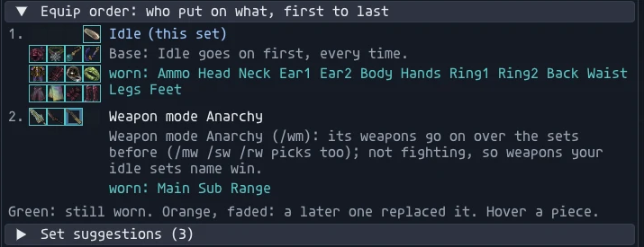

# Set editor: `/gcedit`

[Back to README](../README.md)

Edits your loaded job file. Nothing is written until you save. `/gcedit Savage Blade` opens that set.


## Layout

- **Top bar:** your character and job, the job file (click it for your other job files and **New job file**), the
  save state, then **Rules**, **GoomSwap settings**, **Editor** and **Save + reload**.
- **Editor** menu: Spacing, theme, **Backups**, **Unused gear**, **Rescan bags**, **Reload file**, **Remove /gcbuild
  notes** and Diagnostics.
- **Three panes** of fixed width: your sets, the open set, and the tabs **What goes on**, **Gear**, **Stats**,
  **Compare** (while comparing), **Related** and **To fill**. The Rules page uses the whole width.
- **Window:** opens at about 65% of the screen's width and 63% of its height. Drag the corner to resize it (smallest
  900 × 500). Keep it off other addons' buttons: some, like tHotBar, also react to a click under it.
- **Spacing** (one setting for every job, `EditorSpacing`):
  - **Compact:** icon cards. Each shows the slot, its bag and the icon; hover for the name and stats.
  - **Comfortable:** named cards, with each piece's name and what is under it.
- **Theme** (Editor menu): the bar's colours (default), **Match goomui**, GoomSwap's own, or one of 30 presets.

## Add a set or mode

1. **+ New set** (top of the set list) lists every set you could add, by heading. **+ N to add** under a heading
   lists that heading's. Pick one and **Make** it.
2. Click a slot and pick gear on the **Gear** tab, or press **Use worn**.
3. **Save + reload**, check the review, confirm.

**The add list:**

- Most useful first: names your actions looked for and didn't find, the engine's sets, the job example's, your
  `/mset` and `/wm` modes' sets, your ability groups (DNC: `Step`, `Samba`, `Jig`, `Flourish`), then the job
  abilities and weapon skills you know. Spells are left out (too many).
- Under BUFFS: `Buffs['Saber Dance']` for each of your JAs that has a buff of the same name, worn while the buff is
  up; `Buffs_Ws['Saber Dance']` and `Buffs_Midcast['Saber Dance']` for its weapon skills and spells, when your file
  has `Buffs_Ws` / `Buffs_Midcast`.
- An ability group (`Step`) is a set your job file's HandleAbility puts on for every ability with that word in its
  name, under the ability's own set.
- **More** holds the rarely used ones (Aminon, Sleeping, Doomed...) and abilities a group set covers (Curing Waltz
  III: `Waltz`). You can still make them, for a set of their own.
- Job abilities and weapon skills show **now:** what the action wears until you make its set (`Ws_Default`, your
  `Waltz`, or **no change**: you keep what you have on).
- Each says what it is for; hover it for when it goes on. **Make** creates it empty; **from...** starts it as a copy
  of a set you pick. The new set opens on its first slot, ready to fill.
- Typing filters the list. A name it doesn't have gets its own **Make** (any set, like `Cure IV`), with when it would
  go on. `Weapon_<Name>` opens **New /wm mode** instead.
- Names in `EditorIgnoreSuggestions` (Settings) are left out.
- JOB ABILITIES and NAMED WEAPON SKILLS show even before your first set there.

**How sets are named:**

| Set | Goes on |
|---|---|
| `Savage Blade`, `Trance`, `Cure` | When you use that action. A spell with no set uses its family's (`Cure` for Cure IV). |
| `Savage Blade_Acc`, `Savage Blade_Mpu` | Over it, with `/mset acc` / `/wm mpu` |
| `Tp_Mpu`, `Ws_Mpu` | Over `Tp_Default` / `Ws_Default` while `/wm mpu` is on |
| `Tp_2h`, `Tp_1h` (and `Ws_`, `Dt_`, `Idle_`) | For a weapon with no set of its own, by its Main ([How sets stack](sets.md#how-sets-stack)) |
| `Buffs['Haste']` | While that buff is up. `Buffs_Ws` and `Buffs_Midcast` hold the ones for weapon skills and spells. |

To add a buff set by hand: open `Buffs`, type the buff's name as the game shows it, **New buff set**.

### Weapon modes (`/wm`)

1. Hold the weapons. **+ /wm mode** (on the WEAPONS heading, in Getting started, or the bar's weapon menu).
2. Type the name: `Mpu` gives `Weapon_Mpu` and `/wm mpu`. It must be one word, and not a name `/wm` would read as
   another mode's `/mset` set (`MpuAcc`).
3. **Start from the weapons you hold** fills Main, Sub, Range and Ammo. **Create**.
4. **Weapon sets for /wm Mpu** opens: tick the sets that should differ with it (`Tp_Mpu`, `Ws_Mpu`, `Weapon_Mpu_1h`,
   a weapon skill's...) and **Make**. Layers start empty: fill only what differs.
5. **Save + reload**. The mode is then in `/wm`, F7 and the bar.

- Your job's first mode also becomes **Weapons on load**. **Keep None** in Weapon sets undoes that.
- A `Weapon_` set only puts on Main, Sub, Range and Ammo. Its card shows just those, **Use worn** copies just those,
  and armor in one is flagged with **Move to** `Tp_<Name>` or **Clear them**.
- A `Weapon_` set that `/wm` doesn't list is flagged, with **Add /wm** to add it.
- The engine also wears `Weapon_Mpu_1h` when you can't dual wield, and `Weapon_MpuAcc` (or `Weapon_Mpu_Acc`) with
  `/mset acc`.
- **Delete set...** on `Weapon_Mpu` takes the mode out on Save, and offers to delete the sets worn only with it.
- To start from a set you have, right-click `Tp_Default` (or `Dt`, `Idle`, a WS's set): **Copy as a weapon set**.

### Melee modes (`/mset`)

**+ /mset mode** on the MELEE heading (or the Related tab): name it, tick the sets to make (`Tp_<mode>`, `Ws_<mode>`,
`Dt_<mode>`, `Savage Blade_<mode>`...), **Add**. They start empty: fill only what differs. Save adds the mode to
`gcinclude.MeleeModes`.

### Weapon picks (`/mw` `/sw` `/rw`)

Every item in a `Weapon_` set is a pick already. Add others in **GoomSwap settings**, this job's options (`/mw`,
`/sw`, `/rw` picks). A COR or RNG gun goes in `/rw` picks.

## Rules

**Rules** (top bar) is "when this, wear that" without code, plus **Convert** for your job file's own `if`s.

Most swaps need no rule: a set with an action's exact name goes on by itself. Rules are the extras. In a set's
**More...**, **Wear this when...** opens the rule builder with that set. See [Rules](rules.md).

## New job file

- The file name menu ends with **New job file**. Pick a job, then:
  - **From my gear:** the example with only what you own, as a draft to fill (like `/gcbuild`).
  - **The example** as it is.
  - **Empty sets:** the example's set names, handlers and rules, no gear.
- From GearSwap: `/gcimport <file>` ([Rules](rules.md) for its logic).
- A new file shows **Getting started**: your own gear, what is left to fill, a weapon mode, one Save, the status bar.
  Each step ticks itself. **Hide** hides it until you restart the game.

## Set list

- **Each row:** a dot for its state (amber unsaved, red missing gear, green all 16 slots, teal all 12 armor slots),
  tags for empty slots and pieces you don't own, a violet dot if a piece needs RP, and how many slots it names.
- **Over the list:** how many pieces need RP (hover: which; click: only those sets) and **On you now** (the sets
  wearing something on you).
- **Filters:** Unsaved, Issues, Missing, Needs RP, Unused, Show hidden.
- **Search** by a set's name or an item (`nyame`: every set with a Nyame piece).
- **Hover a set** to see its gear as icons, and what it is for (`Tp_Default`: *Fighting*).
- **Recent** (over the slots): the sets you opened this session.

### Headings

- **Right-click a heading:** Move up / down, **New heading below**, and for your own headings **Rename** and **Remove**.
  **Built-in order** undoes it all.
- **Right-click a set:** **Move to heading**, **Move up / down**. **Back to where its name puts it** undoes the move.
- **Drag a set** onto a heading, or onto another set to put it just before.
- **Hide on** `<JOB>` / **Hide on every job** (heading menu). **Show hidden** shows them again.
- **Sets in it:** **File order**, **A-Z** or **Your order**.
- **Share with every character** puts your headings in the shared settings file. **Only this character** copies them
  back.
- Folded headings stay folded until you restart the game.

Headings are saved in `char.lua` (or the shared file) as `EditorGroups`, `EditorHidden`, `EditorSort` and
`EditorOrder`. By hand:

```lua
EditorGroups = {
    { 'Weapons', 'Weapon_*' },  -- a heading and the set names it takes ('*': any text, any case)
    'Idle', 'Defense', 'Melee', 'Weapon skills', 'Job abilities', 'Casting', 'Named weapon skills', 'Hoxne',
    { 'Two-handed', 'Tp_Chango', 'Ws_Chango' }, -- your own heading: these exact sets
},
EditorHidden = { all = { 'Received' }, WAR = { 'Hoxne' } }, -- hidden on every job / on WAR
EditorSort = { Melee = 'own', Casting = 'az' },             -- 'file' (the default), 'az', 'own'
EditorOrder = { Melee = { 'Tp_Default', 'Tp_Chango' } },    -- 'own': these first, the rest in file order
```

## The open set

- **Title:** heading and name, tags (`2 need RP`...), what it is used for, and how many slots it names. **Used for**
  also names where your job file's code wears it (hover for the lines). A comment right after the set's `{` in the
  file shows as its **Note**.
- **Rename** (More...) is written on Save, with every place your code names the set (`sets.X`, `ByName('X')`) and,
  ticked, its variants (`X_Acc`).
- **Buttons:** **Undo edit** / **Redo**, **Use worn**, **Copy from...**, **Compare...**, **Weapon sets...** (on a
  `Weapon_` set), **More...** (Revert, Rename, Delete, Wear this when...).
- **Click a slot**, then pick an item on **Gear**. Right-click a card: inspect, choose, undo, **Clear slot**, or
  **Set displaced rule**.

| On a card | Means |
|---|---|
| Blue outline | The slot being edited, or hovered |
| No fill | The set leaves this slot alone |
| Amber fill | Unsaved change |
| Violet | Needs RP |
| Bag tag, green / amber / red | Equippable / move it to a wardrobe / not owned |
| Faded icon | Not in this set: an earlier set puts it there (named cards say which) |
| Replaced | A later set of the action picked in What goes on wins this slot |

On Compact's icon cards the words are left out; hover a card for the rest.

### Gear tab (the picker)

- Search by name or stat (`nyame damage`). Three or more letters also list items you don't own, to plan a set.
- Filters: **Any job / level**, **Can equip now**, **Needs RP**, **Augmented**.
- Each row shows what it changes against the piece in the slot (`DT -3%  HP +8`): green better, red worse.
- Drag a row onto a card to put it there.
- **Put in other sets...**: the same piece into the same slot of the sets you tick.
- Changed a piece that other sets still have? Under the grid: **Replace in all N**, **Pick...** or **Not now**.

## Right-side tabs

- **What goes on:** what an action wore, slot by slot, and which set put each piece on. **Equip order** lists the
  layers first to last, with why each went on.
- **Stats:** the set's totals, inherited layers included. Over them, the **caps**: haste, Fast Cast, Snapshot,
  damage taken (physical, magic, breath), each with what is over or left.
- **Compare:** both sets' stats and the difference, or slot by slot.
- **Related:** the sets that go on with this one, in order. The ones you don't have are listed with **make**.
- **To fill:** slots left out, missing or in a bag you can't equip from. Click one, pick the item, and you are back
  in the list for the next. **Fill all** puts one pick in every listed use.




## Across job files

- **The file name** opens your other job files. They are edited without changing your active job, and saved with
  **Save file**.
- **Copy to other jobs** (right-click a set): its pieces into the job files you tick. A piece that job can't wear is
  left out and listed.
- **Find in every job file** (right-click a slot): every set that names the item.
- **/wm order** (right-click a `Weapon_` set): its place in the `/wm` cycle.
- **Unused** (filter): sets nothing seems to look for. **Delete these** stages them. Check first: a set your code
  builds a name for can look unused.
- **Unused gear** (Editor menu): gear in your Inventory and Wardrobes that nothing of this character names.


## Settings

**GoomSwap settings** (top bar) is GoomSwap's own behaviour, for every job file: what an include file's settings are
in GearSwap or LuAshitacast. The editor's own look is in **Editor**.

- Each setting has a plain name (hover: what it does and its key), its value, and where it comes from: **default**,
  **Everyone** (the shared file), your character (`char.lua`) or this job.
- **Applies to** picks where a change goes: all your jobs, this job, or everyone.
- Categories on the left, **find a setting** to search, and this job's options (weapons, picks, Packer...).
- `char.lua` and the shared file are written at once. Changes for this job wait for **Save + reload**.
- A value the engine would refuse is refused here. Details: [Settings](settings.md).

## Save and backups

- **Save + reload** shows a review (each set before and after, new, deleted and renamed sets, modes). Cancel writes
  nothing.
- Saving checks the file didn't change on disk and still loads, writes a dated backup, then reloads.
- Only the sets, rules and settings you changed are rewritten. A set written as code is shown, not edited.
- **Backups** (Editor menu): this file's backups, newest first, each with what differs. **Compare** or **Restore**
  one. The newest 3 are kept (`EditorBackupKeep`; `0` keeps all).
